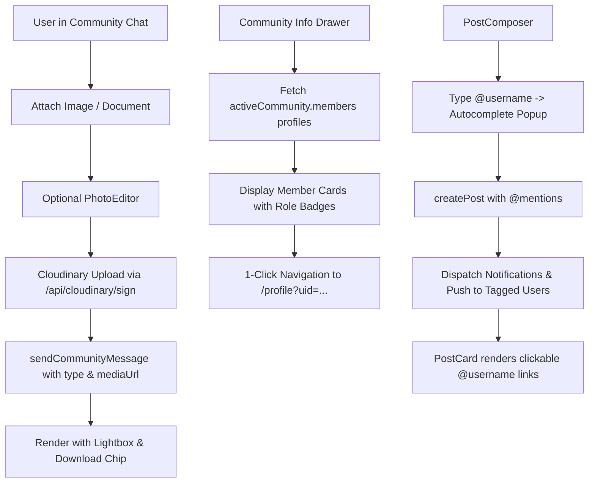

# Implementation Plan: Community Attachments, Member Directory & Feed Mentions

Complete the remaining social and community features requested by the team:
1. **Feed Post Mentions (`@username`)**: Autocomplete in composer, clickable links in post bodies, and real-time mention notifications & push alerts.
2. **Group/Community Attachments**: Image & document attachments in community chats, photo editor integration before sending, and lightbox zoom on tap.
3. **Community Members List & Profiles**: Full member directory in community drawer with role badges, search filter, and 1-click navigation to member profiles.

---

## User Review Required

> [!IMPORTANT]
> **Community Media Storage**: Community attachments will be organized under the secure Cloudinary `messages` folder and signed via the zero-dependency SHA-1 endpoint `/api/cloudinary/sign` with fallback protection, guaranteeing zero 500 errors on Netlify.
>
> **Member Directory Scaling**: Communities may have dozens or hundreds of members. We will load member profiles efficiently using batched profile lookups (`getAllUsers` cache + on-demand batch query) and add a real-time instant search bar in the drawer.

---

## Proposed Changes



---

### Component 1: Feed Post Mentions (`@username`)

#### [MODIFY] [`src/components/feed/PostComposer.tsx`](file:///c:/Users/PraiseTaiwo/Documents/Rhockstar-Connect/src/components/feed/PostComposer.tsx)
- Add mention state:
  - `mentionUsers`: loaded from `getAllUsers()` cache.
  - `mentionQuery`: active string being typed after `@`.
  - `mentionStart` / `mentionEnd`: cursor boundaries.
- Add `@` detector in textarea `onChange` and `onKeyDown`.
- Render an absolute-positioned floating suggestion popover displaying user avatars, full names, and `@handles`.
- When selected, replace the trigger with `@username `.

#### [MODIFY] [`src/lib/services/posts.ts`](file:///c:/Users/PraiseTaiwo/Documents/Rhockstar-Connect/src/lib/services/posts.ts)
- In `createPost`:
  - After post creation, parse all `@([a-zA-Z0-9_]+)` tokens from `content`.
  - Look up matching users.
  - Dispatch in-app notification (`createNotification`) with type `mention` and URL `/feed?postId=${postDoc.id}`.
  - Dispatch real-time web push notification (`sendPushNotification`) to recipient devices.

#### [MODIFY] [`src/components/feed/PostCard.tsx`](file:///c:/Users/PraiseTaiwo/Documents/Rhockstar-Connect/src/components/feed/PostCard.tsx)
- In post body text rendering (lines 620-645):
  - Replace raw `<span>{post.content}</span>` with regex-split mention renderer:
    ```tsx
    post.content.split(/(@[a-zA-Z0-9_]+)/g).map((part, index) =>
      part.startsWith("@") ? (
        <Link
          key={`${post.id}-mention-${index}`}
          href={`/profile?username=${part.slice(1)}`}
          className="text-brand font-semibold hover:underline"
          onClick={(e) => e.stopPropagation()}
        >
          {part}
        </Link>
      ) : (
        <span key={`${post.id}-text-${index}`}>{part}</span>
      )
    )
    ```

---

### Component 2: Group & Community Attachments

#### [MODIFY] [`src/app/(dashboard)/messages/page.tsx`](file:///c:/Users/PraiseTaiwo/Documents/Rhockstar-Connect/src/app/(dashboard)/messages/page.tsx)
- Add community attachment state:
  - `communityMediaFile: File | null`
  - `communityMediaPreview: string | null`
  - `communityEditingImage: File | null`
  - `isUploadingCommunityMedia: boolean`
- In the community message input bar (lines 1960-1990):
  - Add file input `<input type="file" ref={communityFileInputRef} ... />` supporting images and documents.
  - Add media attachment trigger buttons (`Paperclip` / `Image` icon).
  - If selecting an image, open `<PhotoEditor>` for optional crop/draw/filter before sending.
  - Display an attachment preview banner with a thumbnail, file size, and remove button (`X`).
  - In `handleSendCommunityMessage`:
    - Upload via `uploadMediaToCloudinary(communityMediaFile, 'messages', isImg ? 'image' : 'auto')`.
    - Pass `type` and `mediaUrl` to `sendCommunityMessage()`.
- In community messages stream (lines 1850-1930):
  - When `msg.mediaUrl` exists:
    - If `msg.type === 'image'`: Render rounded image preview with `onClick={() => openLightbox([msg.mediaUrl!])}`.
    - If `msg.type === 'document'`: Render document chip with file icon, name, and download link.
    - If `msg.type === 'audio'`: Render inline audio player.

---

### Component 3: Community Members List & Direct Profile Links

#### [MODIFY] [`src/app/(dashboard)/messages/page.tsx`](file:///c:/Users/PraiseTaiwo/Documents/Rhockstar-Connect/src/app/(dashboard)/messages/page.tsx)
- In the Community Info drawer (`isCommunityInfoOpen`):
  - Add `communityMembersList: UserBasic[]` state and `memberSearchQuery: string`.
  - On open or when `activeCommunity.id` changes, resolve profiles for all UIDs in `activeCommunity.members` (using cached `users` state + querying missing UIDs).
  - Add search input to quickly find members in large communities.
  - Render list of member cards:
    - `UserAvatar`
    - Full Name & Username
    - Role badge:
      - `Creator / Admin` (Crown icon, gold badge) for `activeCommunity.creatorId`.
      - `Admin` (Shield icon, purple badge) for `activeCommunity.admins`.
      - `Member` (slate badge) for others.
    - `VerifiedBadge` for subscribers.
    - Clickable link: `<Link href={`/profile?uid=${member.uid}`}>` opening the member's profile page.
    - If current user is Creator or Admin, include an action menu to remove member (`removeMemberFromCommunity`).

---

## Verification Plan

### Automated Tests
```bash
# 1. Typecheck: Verify no TypeScript errors across all modified components
npx tsc --noEmit

# 2. Auth & User suite: Confirm security rules and user services intact
npm run test:auth

# 3. Production Build: Full next build with edge packaging and SW generation
npm run build
```

### Manual Verification
1. **Feed Mentions**:
   - Open `/feed`, type `@` in the post composer, verify user suggestions pop up with avatars and usernames.
   - Select a user, submit post, verify `@username` renders as a clickable purple link leading to that user's profile.
   - Verify the tagged user receives an in-app notification.
2. **Group Attachments**:
   - Open `/messages`, switch to **Communities**, click on any joined community.
   - Click the attachment icon, select an image, verify PhotoEditor opens or thumbnail attaches.
   - Send message, verify image renders in chat bubble, and clicking it opens the full-screen swipeable lightbox.
3. **Community Members Directory**:
   - In community header, click the **Members & Info** icon (`Users` icon).
   - Verify drawer opens displaying the full list of members.
   - Test typing in the member search bar.
   - Click on any member card and verify it navigates directly to their profile (`/profile?uid=...`).
