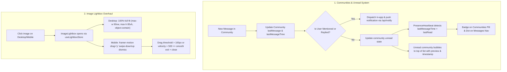

# Implementation Plan: Community Notifications, Image Lightbox Gestures & Community Hub UX

Enhance community communication with unread message tracking, @mention alerts, responsive full-image lightbox with mobile swipe-down-to-dismiss physics, and a modern Discord/WhatsApp-style Community Hub.

---

## User Review Required

> [!IMPORTANT]
> - **Community Notifications Policy**: As aligned in our interview, regular community chat messages will trigger **visual unread badges** and **bubble to the top** of the list; **push and in-app notifications** will be dispatched specifically when a user is **mentioned (`@username`)** or **replied to** in a community thread. This prevents notification fatigue in high-traffic groups.
> - **Navigation Unread Indicators**: The main "Messages" icon in the Sidebar and Mobile Navigation will display a distinct glowing indicator dot when you have unread community messages, while the internal "Communities" tab pill shows the exact unread community count.
> - **Image Lightbox Sizing & Gestures**: On desktop/laptop screens, images will be strictly bounded by `max-w-[90vw]` and `max-h-[85vh]` with `object-contain`, ensuring the entire image is always 100% visible without scroll or clipping. On mobile, `framer-motion` drag physics will allow buttery-smooth swipe-down (or up) to dismiss with dynamic background opacity fade.

---

## Proposed Changes



---

### Component 1: Image Lightbox Gesture & Sizing Overhaul

#### [MODIFY] [`src/components/ui/ImageLightbox.tsx`](file:///c:/Users/PraiseTaiwo/Documents/Rhockstar-Connect/src/components/ui/ImageLightbox.tsx)
- Integrate `framer-motion` for fluid mobile gesture physics:
  - Add `<motion.div>` with `drag="y"`, `dragConstraints={{ top: 0, bottom: 0 }}`, `dragElastic={0.75}`, `onDragEnd` to dismiss when pulled down or up past 100px or on flick velocity (>500px/s).
  - Animate background overlay opacity dynamically based on drag distance (`opacity: 1 - Math.min(Math.abs(y) / 300, 0.7)`).
- Fix Desktop / Laptop image containment:
  - Replace `overflow-auto flex items-center justify-center min-h-full` with a viewport-constrained container.
  - Set `max-w-[90vw] max-h-[85vh] w-auto h-auto object-contain` on the image element so widescreen, landscape, and ultra-tall vertical images are 100% visible at all times.
- Backdrop click-to-close: Clicking outside the image seamlessly dismisses the lightbox.
- Keyboard navigation (Esc, Left/Right arrows, Zoom +/-) preserved and enhanced.

---

### Component 2: Community Unread Tracking & Mention Alerts

#### [MODIFY] [`src/lib/services/communities.ts`](file:///c:/Users/PraiseTaiwo/Documents/Rhockstar-Connect/src/lib/services/communities.ts)
- Update `sendCommunityMessage`:
  - Detect `@username` mentions and `replyToId` in message text.
  - Query referenced users and call `createNotification` for in-app alert:
    `{ type: 'message', title: 'Mentioned in [Community Name]', message: '@sender mentioned you: ...', link: '/messages?communityId=...' }`.
  - Dispatch background push notifications via `/api/notify` for mentioned/replied users.
  - Update community document with `lastMessage`, `lastMessageTime`, `lastSenderId`, and `lastSenderName`.

#### [MODIFY] [`src/store/useAuthStore.ts`](file:///c:/Users/PraiseTaiwo/Documents/Rhockstar-Connect/src/store/useAuthStore.ts)
- Add `unreadCommunities: number` to `AuthState`.
- Add `setUnreadCommunities: (count: number) => void`.

#### [MODIFY] [`src/components/layout/PresenceHeartbeat.tsx`](file:///c:/Users/PraiseTaiwo/Documents/Rhockstar-Connect/src/components/layout/PresenceHeartbeat.tsx)
- Subscribe to `communities` where `members` array contains `profile.uid`.
- Read local read timestamps (`rhockstar_community_read_${communityId}`) or Firestore read markers.
- Count communities where `lastMessageTime > lastReadTime`.
- Sync `setUnreadCommunities(count)` into global auth store.
- Play subtle audio chime when a new message arrives in a joined community while user is active on the platform.

---

### Component 3: Navigation Badges & Global Indicators

#### [MODIFY] [`src/components/layout/Sidebar.tsx`](file:///c:/Users/PraiseTaiwo/Documents/Rhockstar-Connect/src/components/layout/Sidebar.tsx)
- Update "Messages" navigation item:
  - Show numerical badge for unread DMs.
  - If no unread DMs but `unreadCommunities > 0`, render a glowing brand-colored dot indicator on the icon.

#### [MODIFY] [`src/components/layout/MobileNav.tsx`](file:///c:/Users/PraiseTaiwo/Documents/Rhockstar-Connect/src/components/layout/MobileNav.tsx) & [`src/components/layout/MobileHeader.tsx`](file:///c:/Users/PraiseTaiwo/Documents/Rhockstar-Connect/src/components/layout/MobileHeader.tsx)
- Display numerical badge for DMs or glowing indicator dot when `unreadCommunities > 0`.

---

### Component 4: Modern Community Hub UX & Intuitive Directory

#### [MODIFY] [`src/app/(dashboard)/messages/page.tsx`](file:///c:/Users/PraiseTaiwo/Documents/Rhockstar-Connect/src/app/(dashboard)/messages/page.tsx)
- **Top Mode Switcher**:
  - Show glowing counter pill on `Communities` tab button: `Communities (3)` when there are 3 communities with unread messages.
- **Community Card Overhaul (`renderCommunityCard`)**:
  - Display `lastMessage` preview with sender name (e.g. `Alex: Anyone available for tennis this weekend?`).
  - Display relative timestamp (`2m ago`, `1h ago`).
  - Display green/brand unread dot and highlight card border when new messages exist.
  - Sort "Joined" communities dynamically so the ones with the most recent unread activity bubble to the top.
- **Active Community Chat**:
  - When opening a community (`setActiveCommunity`), immediately record `lastReadTime = Date.now()` to clear unread status.
  - Modernize Community Header:
    - Add active community banner/topic summary.
    - Show online/active members indicator.
    - Add quick-action to copy community invite link or share community.
  - Reply preview styling and image zoom integration with the new full-viewport lightbox.

---

## Verification Plan

### Automated Build & Type Checks
```bash
npx tsc --noEmit
npm run test:auth
npm run build
```

### Manual Verification
1. **Desktop Image Lightbox**:
   - Open any post or profile with a portrait, square, or panoramic image.
   - Click the image to open lightbox on laptop screen.
   - Verify the image fits within the screen (`max-h-[85vh]`, `max-w-[90vw]`) without any cropping or overflow.
   - Click outside the image to verify it closes cleanly.
2. **Mobile Image Lightbox**:
   - In mobile view / touch emulator, click an image.
   - Drag down with finger/mouse: verify image follows drag with elastic resistance and overlay fades out.
   - Release: if dragged >100px, verify it smoothly animates out and closes; if released early, it springs back.
3. **Community Unread Indicators & Notifications**:
   - Send a message in a community from User A.
   - On User B's device (joined member):
     - Check that the Community card displays the unread badge and bubbles to the top.
     - Check that the "Communities" mode pill inside Messages shows the unread counter.
     - Check that the sidebar/mobile nav "Messages" icon shows the unread indicator dot.
   - Send a message with `@UserB` or reply to User B:
     - Verify User B receives an in-app notification in their notifications bell and a push alert.
   - Click into the community:
     - Verify unread badge clears immediately.
