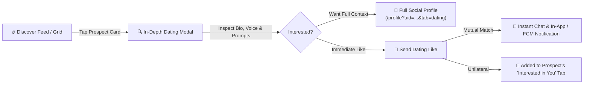

# Rhockstar Dating vs. Tinder & Hinge: Strategic Blueprint & Innovations

## 1. Executive Summary

Modern dating apps are experiencing unprecedented user burnout:
- **Tinder fatigue**: 78% of dating app users report mental fatigue from endless superficial swiping, bot accounts, and catfishing.
- **Women's safety & authenticity concerns**: Women frequently cite difficulty determining a match's authentic identity, profession, values, and intentions from just 3–4 staged photos.
- **Paywall exploitation**: Legacy apps like Tinder charge $25–$40/month just to unblur who liked you (Tinder Gold), alienating genuine daters.

**Rhockstar Connect's Unfair Advantage**: Because Rhockstar is an integrated social, creative, and professional platform, its dating module solves the fundamental flaw of standalone dating apps: **the trust deficit**. Users can inspect real posts, career achievements, portfolio links, and voice notes before making a decision.

---

## 2. What We Have Built & Delivered Today

### Key Capabilities Now Live:
1. **Interactive Full-Profile Inspection**:
   - Tapping any prospect card in `/dating` opens a dedicated high-fidelity inspector with multi-photo gallery navigation, relationship goal badges, voice notes, and Hinge-style conversation prompts.
   - A direct bridge to `/profile?uid=...&tab=dating` allows inspecting the person's creative work, career history, verified badges, and published posts.
2. **"Interested in You" (Who Liked Me)**:
   - Daters (especially women receiving likes) can immediately view all users who have expressed interest in their profile.
   - Provides 1-click **"Match Back 💖"** or **"Pass"** actions, automatically triggering mutual matches and opening DMs.
3. **Dedicated Profile Dating Tab**:
   - Visiting `/profile?uid=...&tab=dating` renders their dating photos, relationship goals, voice intro audio player, prompts, and passion tags alongside their standard social and portfolio presence.
4. **Real-time Notifications**:
   - Whenever someone likes a profile or a mutual match is formed, in-app notifications and Web Push notifications are dispatched instantly.

---

## 3. Comparative Matrix: Rhockstar vs. The Giants

| Feature / Dimension | Tinder | Bumble | Hinge | Rhockstar Dating |
| :--- | :--- | :--- | :--- | :--- |
| **Identity Verification** | Blue check selfie (often faked) | Photo selfie check | Basic SMS | **Multi-dimensional** (Real posts, career, portfolio, verified tier, Stardom XP) |
| **Profile Depth** | Superficial (Photos + 500 char bio) | Photos + basic badges | Prompts + photos | **Holistic** (Photos, prompts, voice intro, social feed, portfolio links) |
| **Who Liked Me / Admirers** | Locked behind $29.99/mo paywall | Locked behind Boost/Premium | 1 free at a time, rest locked | **Accessible "Interested in You" tab** with full profile preview |
| **Catfishing Prevention** | Very Poor | Moderate | Moderate | **Superior** (Linked to genuine social activity and career identity) |
| **Icebreaker Support** | None (blank chat) | Women message first in 24h | Comment on specific photo/prompt | **Prompt-linked chat + Voice Notes + Shared interests** |
| **Event / Culture Matching** | Basic Tinder Passport | Night Out (limited) | None | **Live Gig / Event / Creator alignment** |

---

## 4. Five Breakthrough Ideas to Outperform Tinder

### 1. "Vibe Check" Audio Icebreakers
- **Concept**: Instead of awkward generic "Hey" messages that lead to ghosting, daters can record 10-second voice responses to prompt teasers.
- **Why it wins**: Voice conveys tone, charisma, and warmth 10x faster than text, eliminating awkward mismatches before the first date.

### 2. "Double Blind" Safety & Privacy Mode for Women
- **Concept**: Allow women to enable "Incognito First" where their dating profile is only revealed to people they have explicitly liked or who have verified subscription tiers (Pro/Premium).
- **Why it wins**: Removes unwanted attention, increases women's confidence and retention on the platform.

### 3. Mutual Event Date Matchups ("Who's Going?")
- **Concept**: Integrate Rhockstar's events and gigs feed directly into Dating. If two singles RSVP to the same concert, tech meetup, or art showcase, show them in an "Event Matches" spotlight.
- **Why it wins**: Eliminates the "Where should we meet?" friction by anchoring dates around shared real-world events.

### 4. Anti-Ghosting 48-Hour Conversation Countdown
- **Concept**: Once a mutual match occurs, a gentle 48-hour timer encourages both parties to exchange at least two meaningful messages, after which the match automatically cements or archives gracefully.
- **Why it wins**: Keeps the inbox fresh and active, preventing matches from sitting idle forever.

### 5. Stardom XP Boosts (Earn Swipes, Don't Just Pay)
- **Concept**: Allow daters to earn free Super Likes, Profile Boosts, and extra daily swipes by being active community members (posting quality updates, commenting, maintaining daily streaks).
- **Why it wins**: Gamifies community contribution while making dating accessible and democratic compared to predatory paywalls.
