# Finalized Post-Launch Engineering Implementation Plan

## 1. Goal Description
Execute the complete, production-hardened post-launch roadmap for Rhockstar Connect across all 5 core pillars, fully aligned with the decisions finalized during our technical interview:
1. **Dating Hub Innovations (Dating 2.0)**: 48-Hour Anti-Ghosting Countdown with "Expired Matches" drawer & 1-click reactivate, Pro/Elite "Double-Blind" Incognito Mode, 15s "Vibe Check" Audio Icebreakers, Stardom XP Tiered Swipes (5 $\to$ Unlimited), and Shared Community Circles.
2. **Billing & Payments Automation**: Secure Flutterwave recurring webhook (`/api/payments/webhook`) with +30d rollover extensions, cancellation grace handling, and multi-currency formatting engine.
3. **Self-Serve Ads & Monetization**: Direct Flutterwave advertiser campaign checkout & instant activation.
4. **Enterprise Cybersecurity & Moderation**: Distributed Upstash Redis rate limiting in `middleware.ts` with local fallback, and two-tier automated content safety engine (Severe blocked, Ambiguous flagged to SuperAdmin).
5. **Mobile PWA & Engagement Polish**: Native Web Audio synthesized notification chimes (enabled by default with Settings mute toggle) and service worker badge sync.

---

## 2. Finalized Design Decisions (from Technical Interview)

| Area | Decision Agreed Upon |
| :--- | :--- |
| **48-Hour Match Countdown** | When timer reaches 0 with no messages exchanged, the match moves to an **"Expired Matches"** drawer with a 1-click option to reactivate or extend once. |
| **Incognito Mode** | Exclusive paid perk reserved only for **Pro and Elite subscribers**; hides profile from discover feed unless the user has explicitly liked the prospect first or prospect is verified. |
| **"Vibe Check" Audio Icebreakers** | Profile-based: Daters record a 15-second voice answer to a chosen prompt (e.g. *"Hot take on love"*, *"My weekend energy"*), which plays in the prospect inspector modal and profile. |
| **Stardom XP Swipes** | Tiered scaling: **Explorer** (5/day), **Insider & Connector** (10/day), **Buzzmaker & Trendsetter** (20/day), **Influencer, Superstar & Rhockstar** (Unlimited free swipes). |
| **Webhook Renewals** | On success, extend +30 days from previous expiration date; on cancellation/failed charge, allow user to complete their remaining active days before reverting to free. |
| **Content Moderation** | Two-tier enforcement: Severe offenses (scams, hate speech, malicious URLs) are blocked immediately; ambiguous offenses (phone/telegram links) are published but flagged in SuperAdmin review queue. |
| **Audio Notification Chime** | Enabled by default with a subtle, modern two-tone chime (C5 $\to$ G5 sine-wave chime), plus an on/off toggle in Settings so users can mute it anytime. |

---

## 3. Architecture & Data Flow

```mermaid
flowchart TD
    subgraph Dating["Dating 2.0 Innovations"]
        A["Prospect Discovery"] -->|"Check Incognito"| B{"Is Prospect Incognito?"}
        B -->|"Yes & Liked viewer / Viewer is Pro"| C["Show Prospect"]
        B -->|"Yes & Not Liked"| D["Hide (Double Blind)"]
        B -->|"No"| C
        C -->|"Inspect Prospect"| E["Listen to Vibe Check Audio & View Shared Circles"]
        E -->|"Mutual Match Formed"| F["Matches Tab with 48h Countdown Timer"]
        F -->|"48h expires without chat"| G["Expired Matches Drawer (Reactivate 1x)"]
        H["Stardom XP Rank"] -->|"Calculates"| I["Daily Swipes: 5 -> 10 -> 20 -> Unlimited"]
    end

    subgraph Payments["Payments & Automation"]
        J["Flutterwave Webhook"] -->|"/api/payments/webhook"| K["Verify verif-hash & Idempotency"]
        K -->|"charge.completed"| L["Extend premiumUntil +30d from current expiry & Record in processed_transactions"]
        K -->|"subscription.cancelled"| M["Set subscriptionStatus: cancelled (grace until expiry)"]
        N["Employer Ad Creation"] -->|"Instant Checkout"| O["/api/payments/verify (type: ad) -> Status: active"]
    end

    subgraph Security["Security & Moderation"]
        P["Edge Requests"] -->|"src/middleware.ts"| Q{"Upstash Configured?"}
        Q -->|"Yes"| R["Upstash Redis Sliding Window"]
        Q -->|"No"| S["In-Memory LRU Token Bucket"]
        T["User Post / Message"] -->|"moderation.ts"| U{"Violation Tier?"}
        U -->|"Severe (Scam/Hate/Malware)"| V["Block Submission + Record Alert"]
        U -->|"Ambiguous (Phone/Telegram)"| W["Publish + Flag in SuperAdmin Queue"]
        U -->|"Clean"| X["Publish"]
    end

    subgraph Engagement["Engagement Polish"]
        Y["Real-Time Message / Match"] -->|"PresenceHeartbeat.tsx"| Z{"Notification Sound Enabled?"}
        Z -->|"Yes"| AA["Synthesize Soft Chime (Web Audio API)"]
        Z -->|"No (Muted)"| AB["Silent"]
        Y -->|"Background Push"| AC["App Badge Counter Sync in Service Worker"]
    end
```



---

## 4. Detailed Component Implementation Breakdown

### Component 1: Dating Hub Innovations (Dating 2.0)

#### [MODIFY] `src/lib/services/users.ts`
- Add `datingIncognito?: boolean` and `datingIcebreaker?: { prompt: string; audioUrl: string; duration?: number }` to `UserProfile` and `UserBasic`.

#### [MODIFY] `src/lib/services/dating.ts`
- **Double-Blind Incognito Mode**: In `getDatingProspects`, filter out users with `datingIncognito: true` unless the viewer has been liked by them or viewer is Pro/Elite.
- **48-Hour Anti-Ghosting Match Data**: In `getDatingMatches`, return full match metadata `{ matchId, partner, createdAt, lastMessageAt, isArchived, isExtended }`.
- Add `reactivateExpiredMatch(matchId: string, userId: string)` function.
- Add `getSharedCommunities(userAId: string, userBId: string)` helper.

#### [MODIFY] `src/app/(dashboard)/dating/page.tsx`
- **Dynamic Stardom XP Swipes**: Integrate `calculateStardom(profile.stardomXP)`. Calculate base + rank bonus swipes (5, 10, 20, Unlimited).
- **48-Hour Countdown & Expired Drawer**:
  - Live countdown on match cards: `⏳ 36h to say hello`.
  - Filter matches into "Active Matches" and "Expired Matches" drawer with 1-click Reactivate button.
- **"Vibe Check" Audio Player**:
  - Render an interactive audio card in the prospect modal for the 15s icebreaker note.
- **Shared Circles**:
  - Display shared community badges inside the modal.

#### [MODIFY] `src/components/profile/EditProfileModal.tsx`
- Add Incognito toggle (with Pro/Elite lock if free).
- Add 15s Vibe Check prompt selector and audio recorder/uploader.

---

### Component 2: Payments & Billing Automation

#### [NEW] `src/app/api/payments/webhook/route.ts`
- Flutterwave webhook handler:
  - Validates `verif-hash` header against `process.env.FLUTTERWAVE_WEBHOOK_SECRET_HASH`.
  - Idempotent execution against `processed_transactions`.
  - On `charge.completed`: Extends `premiumUntil` by +30 days from previous expiration (or `Date.now()` if already expired).
  - On `subscription.cancelled`: Sets `subscriptionStatus: 'cancelled'` while keeping `premiumUntil` valid.
  - Sends in-app and FCM push notification to user.

#### [NEW] `src/lib/currency.ts`
- Currency formatter and FX converter supporting `NGN`, `USD`, `GBP`, `EUR`, `KES`, `GHS`, `ZAR`.

---

### Component 3: Self-Serve Ads & Creator Monetization

#### [MODIFY] `src/app/(dashboard)/employer/ads/page.tsx`
- Ensure instant Flutterwave payment activation flow is accessible directly with real-time feedback and status tracking.

---

### Component 4: Enterprise Cybersecurity & Automated Moderation

#### [MODIFY] `src/middleware.ts`
- Add Upstash Redis REST support (`UPSTASH_REDIS_REST_URL` & `UPSTASH_REDIS_REST_TOKEN`).
- Executes atomic sliding-window `INCR` + `EXPIRE` over HTTP on edge.
- Seamless fallback to local in-memory token bucket if Upstash env vars are absent.

#### [MODIFY] `src/lib/services/moderation.ts`
- Implement two-tier enforcement engine:
  - Severe pattern detection (financial scam, crypto doublers, hate speech, malware URLs).
  - Ambiguous pattern detection (external Telegram/WhatsApp soliciting).
  - Automatically records violations to `flagged_content` collection in Firestore with metadata (`reason`, `severity`, `contentSnippet`, `authorId`, `timestamp`).
- Integrate scanner into `posts.ts` and `messages.ts`.

---

### Component 5: Mobile PWA & Engagement Polish

#### [NEW] `src/lib/audioNotifications.ts`
- Native Web Audio API chime generator (C5 523Hz $\to$ G5 784Hz harmonic wave).
- Purely synthetic (0 KB external download).
- Checks local storage preference `rhockstar_sound_enabled` (default: `true`).

#### [MODIFY] `src/components/layout/PresenceHeartbeat.tsx`
- Play soft chime when a new unread message or match notification arrives.
- Ensure app icon badge updates reliably.

#### [MODIFY] `src/app/(dashboard)/settings/page.tsx`
- Add Notification Sound Toggle (Mute / Unmute in-app sound cues).

---

## 5. Verification Plan

### Automated Build Verification
```powershell
npm run build
```
Verify exit code 0, zero TypeScript errors, and successful webpack output.

### Manual Verification Matrix
1. **Dating 2.0**: Test 48h countdown badge, test Vibe Check audio player, verify Stardom XP swipe calculation.
2. **Payments & Webhook**: Test `/api/payments/webhook` signature validation and rollover calculations.
3. **Cybersecurity & Moderation**: Test two-tier moderation rules (severe blocked, ambiguous logged to flagged queue). Test middleware with/without Upstash credentials.
4. **PWA & Audio**: Test Web Audio chime and Settings mute toggle.
