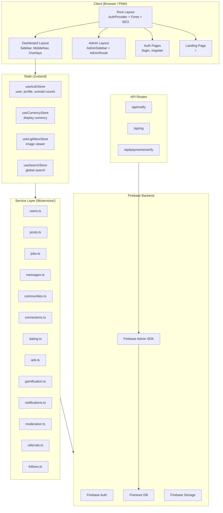

# 🚀 Rhockstar Connect — Project Overview

## What Is It?

**Rhockstar Connect** is a full-stack social networking platform targeting students, freelancers, and young professionals — primarily in Nigeria. It combines **LinkedIn-style professional networking**, a **job board with employer ATS**, **public chat communities** (inspired by 2go), **interest-based dating**, and a **social feed** — all in one PWA.

**Live at**: [rhockstarconnect.com](https://rhockstarconnect.com)

---

## Tech Stack at a Glance

| Layer | Technology |
|---|---|
| Framework | **Next.js 16.2** (App Router) + **React 19** |
| Styling | **Tailwind CSS 4** + custom CSS theme tokens |
| Database & Auth | **Firebase** (Firestore, Auth, Storage) |
| State Management | **Zustand** (4 stores) |
| Payments | **Flutterwave** (Nigerian Naira) |
| Gamification | Custom XP/rank system |
| PWA | `@ducanh2912/next-pwa` |
| Deployment | **Netlify** (CI/CD from `main`) |
| Build | Webpack mode (`next build --webpack`), React Compiler enabled |

---

## Architecture Diagram



---

## Route Map

### Public Routes
| Path | Description |
|---|---|
| `/` | Landing / marketing page |
| `/login` | Email/password + Google OAuth |
| `/register` | Account creation (standard or employer) |
| `/privacy` | Privacy policy |
| `/terms` | Terms of service |

### Dashboard Routes (Protected — requires auth)
| Path | Description |
|---|---|
| `/feed` | Social feed with posts, sponsored ads, post composer |
| `/jobs` | Job search & listings with filters |
| `/jobs/post` | Post a job (employers) |
| `/messages` | DMs + public community chats |
| `/network` | Connections, pending requests, suggestions, blocked |
| `/profile` | Own profile with stats & gamification badges |
| `/dating` | Swipe-style dating discovery |
| `/dating/profile` | Dating profile setup |
| `/employer` | Employer ATS dashboard |
| `/employer/[jobId]` | Applicant tracking for a specific job |
| `/employer/ads` | Create & manage ad campaigns |
| `/companies` | Company directory |
| `/company/[username]` | Public company profile |
| `/settings` | Account, theme, notifications, privacy |
| `/premium` | Subscription tiers (Free/Pro/Elite) via Flutterwave |
| `/notifications` | Notification center |
| `/search` | Global search results |
| `/insights` | Profile analytics |
| `/referrals` | Referral program dashboard |
| `/resources/career` | Career resources |
| `/resources/dating` | Dating tips |

### Admin Routes (Protected — requires `role === 'admin'`)
| Path | Description |
|---|---|
| `/admin/login` | Admin login |
| `/admin` | Admin dashboard overview |
| `/admin/users` | User management |
| `/admin/jobs` | Job moderation |
| `/admin/ads` | Ad review (approve/reject) |
| `/admin/reports` | Content reports |
| `/admin/subscriptions` | Subscription management |
| `/admin/referrals` | Referral oversight |
| `/admin/settings` | Platform settings |
| `/admin/profile` | Admin profile |

### API Routes
| Path | Method | Description |
|---|---|---|
| `/api/notify` | POST | Send email notifications via Firebase `mail` collection |
| `/api/og` | GET | Dynamic Open Graph image generation |
| `/api/payments/verify` | POST | Flutterwave payment verification |

---

## Layout Nesting

```
RootLayout (app/layout.tsx)
│  → Inter font, SEO metadata, JSON-LD structured data
│  → AuthProvider (Firebase onAuthStateChanged → Zustand)
│  → NextTopLoader (page transition bar)
│  → ToastProvider (react-hot-toast)
│
├── (landing)/page.tsx .............. no extra layout
├── (auth)/login + register ........ no extra layout
├── privacy, terms ................. no extra layout
│
├── (dashboard)/layout.tsx ......... DashboardLayout
│   ├── DashboardThemeContainer     (applies selected theme CSS vars)
│   ├── PresenceHeartbeat           (online status heartbeat)
│   ├── MobileHeader                (mobile top bar)
│   ├── Sidebar                     (desktop nav)
│   ├── <main> → ProtectedRoute     (auth gate → redirect /login)
│   │   └── {page content}
│   ├── MobileNav                   (mobile bottom tabs)
│   ├── AIAssistantWidget           (floating AI chat)
│   ├── ImageLightbox               (global image viewer)
│   ├── GlobalSearchModal           (Cmd+K search)
│   └── OnboardingTour              (first-time guide)
│
└── admin/(protected)/layout.tsx ... AdminLayout
    ├── AdminRoute                  (role === 'admin' gate)
    ├── AdminSidebar                (admin nav)
    └── {page content}
```

---

## Auth & Protection Model

> [!IMPORTANT]
> There is **no Next.js middleware** (`middleware.ts`). All auth is **client-side** via React guard components + backend token verification on API routes.

- **`AuthProvider`** (root): Subscribes to Firebase `onAuthStateChanged`, fetches Firestore profile, populates Zustand store. Also handles gamification streak tracking and daily XP awards.
- **`ProtectedRoute`**: Wraps all `(dashboard)` pages. Key behaviors:
  - Redirects to `/login` if unauthenticated
  - **Whitelists public preview paths** (`/feed`, `/profile`, `/company`, `/jobs`, `/terms`, `/privacy`) — these are viewable without login
  - **Ban enforcement**: Checks `profile.isBanned`, triggers alert, force-logout, and redirect
  - **Premium auto-downgrade**: Checks `premiumUntil` against current date — if expired, automatically downgrades subscription from `pro`/`elite` back to `free`/`inactive` in Firestore
- **`AdminRoute`**: Wraps `admin/(protected)` pages. Checks `profile?.role === 'admin'`, redirects to `/admin/login` (unauthed) or `/feed` (non-admin).
- **API Route Protection**: `/api/notify` and `/api/payments/verify` inspect `Authorization: Bearer <token>` headers and verify via `adminAuth.verifyIdToken()`, returning 401 on invalid tokens.

---

## Firestore Collections

| Collection | Key Fields | Purpose |
|---|---|---|
| `users` | uid, fullName, username, email, accountType, role, subscriptionTier, stardomXP, streakCount | User profiles & metadata |
| `posts` | authorId, content, mediaUrl, likesCount, commentsCount | Social feed posts |
| `posts/{id}/comments` | Sub-collection for comments | |
| `posts/{id}/likes` | Sub-collection for tracking likes | |
| `jobs` | companyId, title, location, salary, type, experienceLevel, applications | Job listings |
| `conversations` | participants, lastMessage, lastMessageAt | DM threads |
| `conversations/{id}/messages` | senderId, text, mediaUrl, type, readBy | Individual messages |
| `communities` | name, description, category, creatorId, members, emoji | Public chat rooms |
| `communities/{id}/messages` | senderId, text, timestamp | Community messages |
| `connections` | senderId, receiverId, status (pending/accepted) | Social connections |
| `follows` | followerId, followingId | Follow relationships |
| `advertisements` | companyId, title, content, mediaUrl, status, viewsCount, clicksCount, expiresAt | Sponsored ads |
| `notifications` | recipientId, type, senderId, read | User notifications |
| `reports` | reporterId, contentId, contentType, reason, status | Content reports |
| `mail` | to, message (subject, html) | Firebase trigger emails |

---

## Real-Time Subscriptions

All live via Firestore `onSnapshot`:

| Resource | Service Function | Used In |
|---|---|---|
| Feed posts | `subscribeToFeed()` | `/feed` |
| Sponsored ads | `subscribeToActiveAds()` | `/feed` |
| Direct messages | `subscribeToMessages()` | `/messages` |
| Communities | `subscribeToCommunities()` | `/messages` |
| Community messages | `subscribeToCommunityMessages()` | `/messages` |
| Unread notifications | `subscribeToUnreadCount()` | `AuthProvider` |
| Admin ads review | `subscribeToAllAds()` | `/admin/ads` |

---

## Theme System

5 dynamic themes applied via CSS custom properties on `DashboardThemeContainer`:

| Theme | Accent Color | Background |
|---|---|---|
| **Neon Purple** (default) | `#8b5cf6` violet | `#090314` obsidian |
| **Ocean Blue** | `#3b82f6` blue | `#030a1a` navy |
| **Emerald Green** | `#10b981` emerald | `#031a0e` forest |
| **Rose Pink** | `#f43f5e` rose | `#1a0308` crimson |
| **Amber Gold** | `#f59e0b` amber | `#1a1003` bronze |

Each theme defines radial glow backgrounds, card opacities, border colors, and text colors.

---

## Key Subsystems

### 💰 Payments (Flutterwave)
- Three tiers: **Free**, **Pro**, **Elite**
- Flutterwave integration for Nigerian Naira payments
- Server-side verification at `/api/payments/verify`
- Subscription state stored in user profile (`subscriptionTier`, `premiumUntil`)

### 🎮 Gamification
- **XP system** with **8 Stardom ranks**:
  | Rank | XP Range | Level | Color |
  |---|---|---|---|
  | Explorer | 0–199 | 1 | Slate |
  | Insider | 200–499 | 2 | Sky Blue |
  | Connector | 500–999 | 3 | Teal |
  | Buzzmaker | 1,000–1,999 | 4 | Emerald |
  | Trendsetter | 2,000–3,999 | 5 | Purple |
  | Influencer | 4,000–7,499 | 6 | Rose |
  | Superstar | 7,500–14,999 | 7 | Amber |
  | **Rhockstar** | 15,000+ | 8 | Brand Gradient |
- **Daily streaks** with multipliers (`1.1×` to `1.5×`) tracked in `AuthProvider`
- **Activity rate limits** (daily/hourly caps on check-in, messaging, posting, reacting)
- **Leaderboard** component ranking top 20 users by XP

### 🎁 Referral Program
- 4-tier milestone rewards:
  - **1 invite**: 7 days Free Premium
  - **3 invites**: 7-day Profile Boost
  - **5 invites**: "Featured Professional" badge + 20 job applications
  - **10 invites**: "Rhockstar Legend" VIP badge + 30 days Elite Premium

### 💕 Dating
- Dedicated dating profiles with photos, prompts, voice intro
- Swipe-based matching (like/pass)
- Mutual like detection for matches
- Premium-gated feature

### 📢 Advertising
- Employers create ad campaigns with images/video
- Admin approval workflow (pending → approved/rejected → active)
- Real-time impression and click tracking
- Ads displayed as `SponsoredAdCard` in the feed
- Campaign duration options (7/14/30 days) with auto-expiration

### 🤖 AI Assistant
- Floating widget on all dashboard pages
- Provides contextual help and guidance
- Toggle visibility via settings

---

## Notable Architectural Patterns

> [!TIP]
> These patterns are important to understand when making changes to the codebase.

- **Firestore WriteBatch Cascades**: When a user updates their profile (name, avatar, handle) via `updateUserProfile()`, a multi-document `writeBatch` cascades updates across all their existing `posts`, `jobs`, and `notifications` to maintain denormalized consistency.
- **`debounceSnapshot()`** utility: Batches high-frequency Firestore `onSnapshot` callbacks (default 150ms) to maintain 60fps rendering under heavy real-time traffic.
- **Reserved Usernames**: 50+ handles (`admin`, `official`, `support`, `verified`, `rhockstar`, `bot`, `api`, etc.) are blocked from registration and profile updates.
- **Currency Formatting**: `useCurrencyStore.formatPrice(amountInUSD)` converts USD to NGN (×1500), EUR (×0.92), GBP (×0.79) with proper symbols.
- **Realtime Database**: In addition to Firestore, the project initializes Firebase Realtime Database (`rtdb`) — used alongside Firestore for certain presence/typing features.
- **Client-side Image Compression**: `PostComposer` compresses images via canvas before uploading to Firebase Storage.
- **Deterministic Match IDs**: Dating matches use `[fromId, toId].sort().join('_')` to ensure unique, idempotent match documents regardless of who liked first.

---

## Notable Files Outside `src/`

| File | Purpose |
|---|---|
| [`next.config.ts`](file:///c:/Users/PraiseTaiwo/Documents/Rhockstar-Connect/next.config.ts) | PWA config, React Compiler, image domains, cache headers |
| [`netlify.toml`](file:///c:/Users/PraiseTaiwo/Documents/Rhockstar-Connect/netlify.toml) | Build config, domain redirect, API rate limiting |
| [`firestore.rules`](file:///c:/Users/PraiseTaiwo/Documents/Rhockstar-Connect/firestore.rules) | Firestore security rules |
| [`firestore.indexes.json`](file:///c:/Users/PraiseTaiwo/Documents/Rhockstar-Connect/firestore.indexes.json) | Composite index definitions |
| [`storage.rules`](file:///c:/Users/PraiseTaiwo/Documents/Rhockstar-Connect/storage.rules) | Firebase Storage security rules |
| `fix_*.py`, `find_*.py` | ~100+ Python scripts used for automated bug-fixing and code refactoring |
