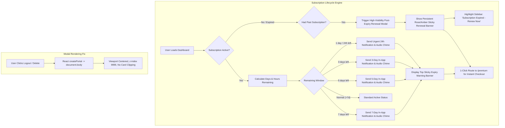

# Implementation Plan: Subscription Expiry Reminder Suite & Critical Bug Fixes

This plan outlines the architecture and changes to address three core issues reported on Rhockstar Connect:
1. **Logout Confirmation Modal UI**: Fix the modal being clipped/scrolled off-screen due to parent container CSS transforms and stacking contexts.
2. **Subscription Expiry & Renewal System**: Implement milestone countdown reminders (7 days, 5 days, 3 days, 1 day), in-app notifications with audio chimes, a persistent sticky dashboard banner, a high-visibility post-expiry renewal modal, and sidebar renewal alerts.
3. **Super Admin Users Page Crash (`ReferenceError: ShieldAlert is not defined`)**: Fix missing imports in [`src/app/admin/(protected)/users/page.tsx`](file:///c:/Users/PraiseTaiwo/Documents/Rhockstar-Connect/src/app/admin/(protected)/users/page.tsx) and [`src/app/(dashboard)/messages/page.tsx`](file:///c:/Users/PraiseTaiwo/Documents/Rhockstar-Connect/src/app/(dashboard)/messages/page.tsx) that trigger the error boundary ("Connecting to Feed...").

---

## Architecture & Workflow Overview



---

## User Review Required

> [!IMPORTANT]
> **Subscription Milestone Notification Frequency**:
> To prevent spamming users every time they refresh the page, each milestone notification (`7d`, `5d`, `3d`, `1d`, `expired`) will be sent **once per billing cycle** by recording triggered milestones in the user's Firestore document (`subscriptionRemindersSent: string[]`). When the user renews, this list is automatically reset.
> 
> **Post-Expiry Renewal Modal vs Sticky Banner**:
> When a user's subscription expires:
> - A prominent **Subscription Expired Modal** opens once per session explaining which perks are paused (verified badge, dating boosts, unlimited chat) with an instant "Renew Subscription" CTA.
> - If dismissed, a **Sticky Dashboard Banner** stays at the top of the screen permanently until the user renews.

---

## Open Questions

- None blocking. The requirements specify 7-day, 5-day, 3-day, and 1-day reminders, a clear post-expiry screen, and fixing the modal and admin crashes.

---

## Proposed Changes

Grouped logically by component:

---

### Component 1: Fix Modal Clipping (Logout & Delete Modals)

#### [MODIFY] [`src/components/auth/LogoutConfirmModal.tsx`](file:///c:/Users/PraiseTaiwo/Documents/Rhockstar-Connect/src/components/auth/LogoutConfirmModal.tsx)
- Use `createPortal(..., document.body)` with an SSR `mounted` guard.
- Set `z-[9999]` so the modal mounts directly onto the DOM root (`body`), bypassing all ancestor transforms, `backdrop-blur-md` filters, or container scroll constraints that caused the clipping in Image 1.

```tsx
import { createPortal } from "react-dom";
import { useState, useEffect } from "react";

export default function LogoutConfirmModal({ isOpen, onClose }: LogoutConfirmModalProps) {
  const [mounted, setMounted] = useState(false);
  useEffect(() => setMounted(true), []);

  if (!isOpen || !mounted) return null;

  return createPortal(
    <div className="fixed inset-0 z-[9999] flex items-center justify-center p-4 bg-black/80 backdrop-blur-sm animate-in fade-in">
      ...
    </div>,
    document.body
  );
}
```

#### [MODIFY] [`src/app/(dashboard)/settings/page.tsx`](file:///c:/Users/PraiseTaiwo/Documents/Rhockstar-Connect/src/app/(dashboard)/settings/page.tsx)
- Wrap the Delete Account confirmation modal with `createPortal(..., document.body)` so it cannot suffer from the same card clipping.
- Update the Subscription tab display to show an obvious "Expired" status with a renewal CTA when `premiumUntil` is in the past.

---

### Component 2: Subscription Reminder & Post-Expiry Renewal Suite

#### [NEW] [`src/components/subscriptions/SubscriptionLifecycleManager.tsx`](file:///c:/Users/PraiseTaiwo/Documents/Rhockstar-Connect/src/components/subscriptions/SubscriptionLifecycleManager.tsx)
A dedicated client-side component rendered inside [`src/app/(dashboard)/layout.tsx`](file:///c:/Users/PraiseTaiwo/Documents/Rhockstar-Connect/src/app/(dashboard)/layout.tsx):
- Calculates remaining time in milliseconds, days, and hours based on `profile.premiumUntil`.
- **Milestone Engine**:
  - `7d`: $6 < \text{days} \le 7$
  - `5d`: $4 < \text{days} \le 5$
  - `3d`: $2 < \text{days} \le 3$
  - `1d`: $0 < \text{msRemaining} \le 24\text{ hours}$
  - `expired`: $\text{msRemaining} \le 0$
- If a milestone is reached and not in `profile.subscriptionRemindersSent`:
  1. Creates an in-app notification in Firestore collection `notifications` with `type: 'subscription'`, title, message, link `/premium`.
  2. Plays the audio chime (`playNotificationChime`).
  3. Updates Firestore user document `subscriptionRemindersSent = arrayUnion(milestone)`.
- If expired, automatically triggers the downgrade to `subscriptionTier: 'free'`, `subscriptionStatus: 'inactive'`, marks `expired` milestone, and surfaces the renewal modal.

#### [NEW] [`src/components/subscriptions/SubscriptionBanner.tsx`](file:///c:/Users/PraiseTaiwo/Documents/Rhockstar-Connect/src/components/subscriptions/SubscriptionBanner.tsx)
A sticky banner rendered at the top of the dashboard content area in [`src/app/(dashboard)/layout.tsx`](file:///c:/Users/PraiseTaiwo/Documents/Rhockstar-Connect/src/app/(dashboard)/layout.tsx):
- **Expiring Soon State ($\le 7$ days)**:
  - Yellow/Amber banner:
    "⏳ **Your [Tier] subscription expires in X days** (on [Date]). Renew early to keep your verified badge, dating boosts, and unlimited messages uninterrupted. **[Renew Now &rarr;]**"
  - **Urgent State ($\le 24$ hours)**:
    "🚨 **Urgent: Your subscription expires in X hours!** Don't lose your perks. **[Renew Instantly &rarr;]**"
- **Expired State**:
  - High-visibility Rose/Amber banner:
    "⚠️ **Your Premium Subscription Has Expired.** Your verified badge and premium perks are currently paused. **[Renew Subscription &rarr;]**"

#### [NEW] [`src/components/subscriptions/SubscriptionExpiredModal.tsx`](file:///c:/Users/PraiseTaiwo/Documents/Rhockstar-Connect/src/components/subscriptions/SubscriptionExpiredModal.tsx)
A high-impact modal (teleported to `document.body` via `createPortal`):
- Displays a glowing expired crown icon.
- Clear title: **"Your Premium Subscription Has Ended"**.
- List of paused benefits (Verified Badge, Unlimited Direct Messages, Dating Stardom Boost, 0% Ad-Free experience).
- Direct **"Renew My Premium"** button that navigates to `/premium`.
- "Maybe Later" button (dismisses modal for current browser session while the top sticky banner remains).

#### [MODIFY] [`src/lib/services/notifications.ts`](file:///c:/Users/PraiseTaiwo/Documents/Rhockstar-Connect/src/lib/services/notifications.ts)
- Add `'subscription'` to the `Notification.type` union type.

#### [MODIFY] [`src/app/(dashboard)/notifications/page.tsx`](file:///c:/Users/PraiseTaiwo/Documents/Rhockstar-Connect/src/app/(dashboard)/notifications/page.tsx)
- Add `case "subscription"` to notification icon mapper (Crown icon, amber color) and router click handler (navigates to `/premium`).

#### [MODIFY] [`src/components/layout/Sidebar.tsx`](file:///c:/Users/PraiseTaiwo/Documents/Rhockstar-Connect/src/components/layout/Sidebar.tsx)
- Enhance the bottom-left sidebar card:
  - If user had a subscription that expired, display:
    "⚠️ **Subscription Expired**"
    "Your perks are inactive. Renew today to get your verified badge back."
    "**[Renew Subscription]**" with a glowing amber/rose border.

#### [MODIFY] [`src/app/api/payments/verify/route.ts`](file:///c:/Users/PraiseTaiwo/Documents/Rhockstar-Connect/src/app/api/payments/verify/route.ts) & [`src/lib/services/admin.ts`](file:///c:/Users/PraiseTaiwo/Documents/Rhockstar-Connect/src/lib/services/admin.ts)
- Upon successful renewal or grant, reset `subscriptionRemindersSent: []` so that the user receives the fresh reminder sequence for their new cycle.

---

### Component 3: Fix Super Admin Users Page Crash & TypeScript Errors

#### [MODIFY] [`src/app/admin/(protected)/users/page.tsx`](file:///c:/Users/PraiseTaiwo/Documents/Rhockstar-Connect/src/app/admin/(protected)/users/page.tsx)
- Import `ShieldAlert` and `AlertTriangle` from `lucide-react`.
- Import `auth` from `@/lib/firebase`.
- This eliminates the runtime `ReferenceError: ShieldAlert is not defined` and stops the ErrorBoundary from rendering "Connecting to Feed...".

#### [MODIFY] [`src/app/(dashboard)/messages/page.tsx`](file:///c:/Users/PraiseTaiwo/Documents/Rhockstar-Connect/src/app/(dashboard)/messages/page.tsx)
- Import `db` on line 273: `const { db } = await import('@/lib/firebase');`.
- Fix `size="xs"` to `size="sm"` on `UserAvatar` on line 2003.

---

## Verification Plan

### Automated Tests
1. **TypeScript Verification**:
   ```powershell
   npx tsc --noEmit
   ```
   Confirm zero missing symbol errors in `admin/users/page.tsx` and `messages/page.tsx`.

2. **Auth Health Suite**:
   ```powershell
   npm run test:auth
   ```
   Confirm all 5 probes pass.

3. **Production Build Validation**:
   ```powershell
   npm run build
   ```
   Confirm clean compile with exit code 0.

### Manual Verification
1. **Logout Confirmation Modal**:
   - Navigate to `/settings`, scroll down to "Danger Zone", click "Logout Account".
   - Verify modal is perfectly centered on the screen with full dark backdrop dimming, not clipped at the top of the card.
2. **Super Admin Users Page**:
   - Navigate to `/admin/users`.
   - Confirm page loads immediately with the user table, search bar, and "Audit Auth Sync" button with the shield icon, with no "Connecting to Feed..." crash screen.
3. **Subscription Reminders & Expiry Banner**:
   - For an expired subscription:
     - Check sticky top banner: "Your Premium Subscription Has Expired. [Renew Subscription]".
     - Check sidebar card: "Subscription Expired - Renew Subscription".
     - Check that clicking "Renew" routes to `/premium`.
   - For active subscriptions approaching expiry:
     - Verify reminder banners at 7d, 5d, 3d, and 1d.
